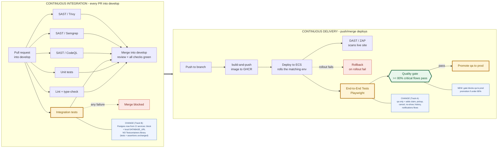
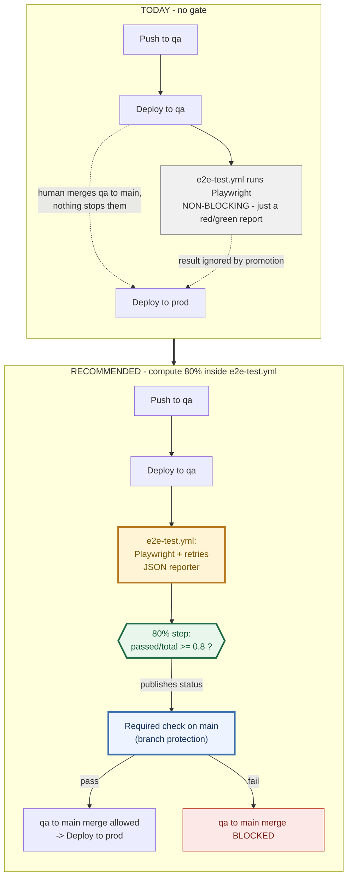

# Integration Testing Against the Real Environment (Consolidated Plan)

This is the single, authoritative plan. It supersedes and replaces the earlier
working notes (`testcontainers-to-live-env-investigation.md`,
`strategy-b-implementation-plan.md`, `option-b-scope.md`, and
`docs/testcontainers-explained.md`), which were investigation scratch and are
removed.

Repo: `rescufood` monorepo (Windows, PowerShell). Region `ap-southeast-1`.

---

## 1. The requirement and the goal

- **Requirement (clarified):** integration tests must **run against the real /
  deployed environment** — not an emulator, not a local container, not
  Testcontainers.
- **Deadline:** end of tomorrow.
- **Minimal changes** preferred.
- A teammate will later decide whether these tests become a **quality gate**,
  ideally **> 80%**. The suite must therefore be stable and meaningful.

The key consequence: a dedicated/local Postgres (even one not started by
Testcontainers) does **not** satisfy "the real deployed environment." The only
thing in this repo that already tests the deployed stack black-box is the
**Playwright e2e suite** (`e2e/`, `.github/workflows/e2e-test.yml`). That is the
vehicle this plan builds on.

---

## 2. Where we are today

### 2.1 The in-process "integration" suites (what has Testcontainers)

Three suites start a throwaway Postgres 17 *from inside the test process* via
the `testcontainers` library, migrate it, wipe it per test, seed, and assert:

| Service | Language | Testcontainers package | Harness entry point |
|---|---|---|---|
| `service/profile` | Go | `testcontainers-go` + `.../modules/postgres` | `integration/main_test.go` |
| `service/listings` | NestJS/TS | `@testcontainers/postgresql` | `test/integration/support/global-setup.ts` |
| `service/notifications` | NestJS/TS | `@testcontainers/postgresql` | `test/integration/support/global-setup.ts` |

These are **in-process component tests**. They load the app's own code and point
it at Postgres, but **fake everything else**: Cognito/JWT is stubbed, the mailer
is a spy, and the SQS poll loop never starts (the handler is called directly).
Only Postgres is real. **Testcontainers is used nowhere else in the repo** — the
only other mentions are documentation (workflow README/comments, slides) and
transitive lock-file dependencies.

Against the clarified requirement these suites are **mislabelled**: they are not
integration tests against the deployed environment. They are valuable
*component/data-layer* tests, but they do not meet the lecturer's bar.

> **Terminology (decided — Testcontainers is removed regardless).** Because
> Testcontainers was presented and the lecturer did not approve it, we remove it
> from these suites (Track B) rather than keep it under a different label — this
> avoids relitigating the point. The accurate name for what remains is
> **component tests** (they load app code and hit a real Postgres but fake
> Cognito/SQS/email), and the word **"integration"** is reserved for the
> Playwright suite against deployed qa. Physically renaming the
> `test:integration` scripts, `jest-integration.json`, the Go `//go:build
> integration` tag, and the `integration/` folders is **optional later cleanup**
> (real churn, saved for after the deadline); the conceptual relabel lives here
> and in the docs/slides. The removal of Testcontainers itself is **not**
> deferred.

### 2.2 The Playwright e2e suite (already real-environment)

`e2e/` + `.github/workflows/e2e-test.yml` already does exactly what the
requirement asks:

- Signs in through the **real Cognito** login page (donor + rescue-partner test
  accounts), saving sessions via `tests/auth.setup.ts` →
  `tests/fixtures/sessions.ts`.
- Drives the **deployed** site at `BASE_URL` (real browser → API Gateway → ALB →
  ECS → RDS), against **dev/qa** (never prod/`main`).
- CI waits for every ECS service to settle, then runs `npx playwright test`.

Current coverage (in `e2e/tests/`): `login`, `access-control`,
`donor-dashboard`, and the listing lifecycle (`listing-happy-path`,
`listing-cancel`, `listing-draft-delete`, `listing-edit-cancel`).

**Gap:** it does *not* yet cover the cross-service flows the integration suites
exercise — claiming a listing, pickup completion, claim cancellation / no-show /
history, and notification delivery. Those are the scenarios to port.

### 2.3 What changes in the pipeline (against the existing CI/CD)

The existing pipeline is unchanged except for three highlighted spots. Yellow =
changed, green = new, blue = explanation. Everything else (Lint, Unit tests, all
SAST scanners, the merge gate, build-and-push, Deploy, Rollback, DAST/ZAP) stays
exactly as today.

The three changes:

1. **CI → Integration tests (Track B):** still a PR check, still report-only;
   Postgres now comes from a CI `services:` block (or local `DATABASE_URL`)
   instead of the Testcontainers library. Tests and assertions are unchanged —
   only *who starts Postgres* changes.
2. **CD → End-to-End Tests (Track A):** the existing Playwright step grows the
   cross-service flows (claim, pickup, cancel, no-show, history, notifications)
   and targets **qa only**. This is what satisfies "integration must run against
   the real environment."
3. **CD → Quality gate (new):** a ≥ 80%-of-critical-flows gate decides qa → prod
   promotion. Today the e2e step is a non-blocking smoke check; the change is
   making its result actually gate promotion.

Two caveats so the diagram is not read as already-true: the current e2e step
runs on **dev + qa** today, and this plan deliberately narrows it to **qa only**
(dev is routinely paused); and the quality gate is the **future** step the
teammate will assess — it is not wired yet. The diagram shows the target state.

---

## 3. Plan: make Playwright the real-environment integration suite

Two tracks. Track A is the deliverable that meets the requirement; Track B is
cheap hygiene that resolves the Testcontainers label on the in-process suites.

### Track A — Grow the Playwright suite to cover the integration scenarios (the requirement)

Port the cross-service flows currently proven in-process into black-box
Playwright specs that run against deployed dev/qa, reusing the existing auth
fixtures and page helpers. Concretely, add specs under `e2e/tests/` for:

1. **Claim flow** — a rescue partner claims an available listing; donor sees it
   reserved. (mirrors listings `claim-*`, `requests.e2e`.)
2. **Pickup completion** — claimed → picked up/completed, both roles' views.
   (mirrors `pickup.e2e`.)
3. **Claim cancellation / no-show / history** — the lifecycle edges.
   (mirrors `claim-cancellation/-no-show/-history`.)
4. **Notification delivery** — after a claim/pickup, the recipient sees the
   in-app notification through the UI/API. (mirrors notifications suite — note
   email delivery can only be checked indirectly.)

Conventions to follow (already established in `e2e/`):
- Use `donorPage` / `partnerPage` fixtures (`tests/fixtures/sessions.ts`); don't
  log in/out per test.
- Create uniquely-named data per test (UUID-tagged titles/slugs) and **assert on
  your own data by id/name**, never on global counts — the environment is shared
  and other runs' data is present. No `TRUNCATE`, ever.
- Keep `concurrency` one-run-per-environment (already in `e2e-test.yml`) because
  the suite shares fixed test accounts and writes real data.

**What you cannot carry over** (be explicit with your teammate): fine-grained
data-layer assertions the in-process suites make — exact audit-row metadata,
append-only trigger behavior, repository idempotency internals — are not visible
black-box. Assert on user-visible behavior instead. This is an inherent property
of "test against the real environment," not a shortcut.

### Track B — Remove Testcontainers from the in-process suites (hygiene, keep them as fast data-layer tests)

The in-process suites still have value as fast PR-time data-layer checks. To
honor "no Testcontainers" on them without the live-RDS complexity, have their
Postgres provided **externally** instead of by the `testcontainers` library:

- **CI:** a Postgres 17 **service container in the workflow YAML** (GitHub
  Actions `services:` block) — started by the runner, not the test process.
- **Local:** a Postgres via `DATABASE_URL` (reuse the repo's `Makefile db` /
  `podman compose`).

Per service (test/harness + CI only — **no production code, no assertion or seed
changes**, the wipe stays because the DB is disposable):

- **profile** (`service/profile/integration/main_test.go`): replace the
  `tcpostgres.Run(...)` + `ConnectionString(...)` block in `TestMain` with
  `os.Getenv("DATABASE_URL")` (fail fast if unset); drop the
  `TerminateContainer` teardown; keep `runMigrations` + `createAuditLog` + the
  `TRUNCATE` resets. Remove the two `testcontainers-go` requires from `go.mod`
  and the imports; `go mod tidy`.
- **listings** (`test/integration/support/global-setup.ts` / `-teardown.ts` /
  `db.ts`): remove the `PostgreSqlContainer` start/stop, the `globalThis` stash,
  and the URL cache file; reduce setup to "require `DATABASE_URL`, then
  `migrate()`". Drop the `?? readFileSync(DATABASE_URL_FILE)` fallback. Remove
  `@testcontainers/postgresql` from `package.json`; `npm install`.
- **notifications**: same edits as listings (different cache/global names).

Track B needs **no infrastructure and no teammate** — the CI Postgres is a
workflow service container.

### Why split it this way

- Track A is what actually satisfies "integration tests against the real
  deployed environment," and it reuses infrastructure that **already exists and
  works** (Cognito login, ECS-settle wait, dev/qa `BASE_URL`), so it is feasible
  by the deadline.
- Track B removes the Testcontainers label from the in-process suites cheaply,
  so nothing in the repo starts a container via the library, while keeping those
  tests as fast data-layer coverage. It is optional for the requirement but
  cheap and worth doing.

### 3.1 Files touched (exhaustive) — no production code

The boundary: **test files + their dependency manifests + CI workflow YAML +
docs. Zero application/production source** (`web/`, `service/*/src/`,
`service/profile/internal/`, infrastructure/CloudFormation) is modified.

**Track A — grow Playwright (the requirement):**
- New spec files under `e2e/tests/` (claim, pickup, cancel, no-show, history,
  notifications).
- Possibly small additions to `e2e/tests/fixtures/` or `e2e/tests/pages/`
  helpers if shared steps are needed.
- `e2e/playwright.config.ts` — only if we add `retries` for the gate (§5.5).

**Track B — remove Testcontainers from the in-process suites (hygiene):**
- Test harness files:
  - `service/profile/integration/main_test.go`
  - `service/listings/test/integration/support/{global-setup.ts,global-teardown.ts,db.ts}`
  - `service/notifications/test/integration/support/{global-setup.ts,global-teardown.ts,db.ts}`
- Dependency manifests (shared files, not "test" files — required to drop the
  dependency): `service/profile/go.mod` + `go.sum`;
  `service/listings/package.json` + `package-lock.json`;
  `service/notifications/package.json` + `package-lock.json`.
- CI workflow YAML: `.github/workflows/{profile-ci.yml,listings-ci.yml,notifications-ci.yml}`
  (add the `services:` Postgres block + `DATABASE_URL`).

**Docs (recommended):**
- `docs/integration-testing-plan.md` (this file).
- Testcontainers references in `service/listings/README.md`,
  `service/notifications/README.md`, `.github/workflows/README.md`, and
  `slides/slides.md`.

**Honest note:** the dependency manifests and CI YAML are not inside a test
directory, so "only test files change" is not literally true — but **no
production code changes.** Removing a dev/test dependency necessarily edits the
manifests, and providing Postgres necessarily edits the CI jobs.

---

## 4. What you can do yourself vs. what needs a teammate

**Target environment: qa only.** qa is fully configured and is not routinely
paused (dev is stopped by `make aws-pause`), so all e2e work — local and CI —
targets **qa** (`https://qa.rescufood.com/`). dev is out of scope for this plan.

**Yourself (no infra access):**
- All of Track A's spec-writing (porting flows into `e2e/tests/`).
- All of Track B's code + workflow edits.
- Running the e2e suite locally against qa by setting `BASE_URL` + the four
  test-account vars in `e2e/.env` (see `e2e/README.md`).

**No teammate step needed — the secrets already exist.** Verified via `gh`:
the `qa` GitHub Environment already has the four `TEST_*` secrets and a
`BASE_URL` variable (`https://qa.rescufood.com/`), and `AWS_ACCESS_KEY_ID` /
`AWS_SECRET_ACCESS_KEY` exist at repo level. So `e2e-test.yml` can run against qa
with no further configuration. No RDS, VPC, IAM, or tunnel — this path
deliberately avoids the live-RDS approach (§6).

---

## 5. Quality gate — definition and placement

### 5.1 The gate definition (agreed)

The quality gate is: **≥ 80% of critical user flows pass.** This is a *flow
pass-rate*, not code-coverage — Playwright is flow-based and does not emit
line/branch coverage, so the 80% is measured against an explicit list of
critical flows, not against source lines. (Line/branch coverage, if ever wanted,
comes from the unit + in-process integration suites' `test:coverage` /
`coverage.sh` output, not from Playwright.)

### 5.2 The critical-flow list (the denominator)

The 80% is measured against this named set. The gate is meaningless without an
agreed list, so this is the list; adjust it with the teammate as the product
changes. Each is one Playwright spec/flow:

1. Login / auth (donor + rescue partner) — *exists*
2. Access control (role boundaries) — *exists*
3. Listing happy path (create → publish) — *exists*
4. Listing cancel / draft-delete / edit-cancel — *exists*
5. **Claim** a listing (partner) — *Track A, to add*
6. **Pickup completion** — *Track A, to add*
7. **Claim cancellation** — *Track A, to add*
8. **No-show** — *Track A, to add*
9. **Claim history** — *Track A, to add*
10. **Notification delivery** (in-app, via UI) — *Track A, to add*

Playwright's run summary reports passed/failed counts directly, so "≥ 80%
passed" is computable from the run (a small CI step can parse the JSON reporter
output and fail the gate on the ratio).

### 5.3 Caution on an 80% pass-rate

An 80% *pass-rate* tolerates ~1 in 5 critical flows being broken, which is
lenient for a promotion gate. The usual reason to allow < 100% is flakiness —
and the correct fix for flakiness is Playwright `retries` (e.g. `retries: 2` on
CI in `playwright.config.ts`), not a lowered bar. Recommended framing: **≥ 80%
to pass the gate, but investigate every failure** — do not treat 20% breakage as
acceptable steady state.

### 5.4 Where the gate lives

The e2e suite is a **post-deploy** check today (runs after a deploy to qa, not on
PRs, by design — it writes real data). So the natural placement is a
**post-deploy / promotion gate** on qa: the ≥ 80% result gates promotion (qa →
prod), not a pre-merge PR merge. `e2e-test.yml` is intentionally non-blocking as
wired; turning it into a promotion gate means gating the *promotion* step on its
outcome, not adding it as a PR branch-protection check.

A **pre-merge** Playwright gate would require deploying each PR to a preview
environment first (ephemeral env per PR, or serialized shared dev) — real infra
work, out of scope for the deadline. If a fast per-PR gate is wanted, the
in-process suites (Track B — fast, hermetic) fit that slot; Playwright gates
promotion.

### 5.5 Operational prerequisites for a trustworthy gate

- Keep `concurrency` one-run-per-environment (already in `e2e-test.yml`).
- Set `retries` on CI so transient blips don't fail the gate while real breaks
  still surface.
- Target **qa only** — it is fully configured and not routinely paused (dev is
  stopped by `make aws-pause`, so dev is excluded from this plan).

---

## 6. Fallback — re-point the in-process suites at live dev/qa RDS (NOT recommended)

If the requirement is read as "the *in-process* suites themselves must hit the
real RDS" (rather than "we have real-environment integration coverage via
Playwright"), the work balloons: point the suites at dev/qa RDS over an SSM
tunnel, which forces removing the wipe, uniquifying all of profile's hard-coded
seed values, and rewriting ~32 whole-table-count assertions across 8 files to be
owner-scoped — rated **3–4 days**, needs a **teammate with infra access** (IAM
for the tunnel), makes the suite slower/flakier, and *still* leaves
Cognito/SQS/S3/email faked (only Postgres becomes real). Playwright reaches the
real environment more completely with far less risk. **Do not take this path for
the deadline.** The detailed file-and-line inventory for it existed in the
removed working notes; regenerate only if actually chosen.

---

## 7. Suggested order for tomorrow

1. Run the existing e2e suite locally against **qa** (`e2e/.env` with
   `BASE_URL=https://qa.rescufood.com/` + the qa test accounts) to confirm the
   baseline is green and you understand the fixtures.
2. Track A: add the **claim** flow spec, then **pickup**, then
   **cancellation/no-show/history**, then **notification delivery** — in that
   order, verifying each against qa as you go.
3. Track B (if time allows): remove Testcontainers from the three in-process
   suites and switch their CI jobs to a `services:` Postgres.
4. Update docs/README/slides references that describe integration tests as
   "Testcontainers / real PostgreSQL."

(The CI secrets step from earlier drafts is removed — the qa Environment secrets
and `BASE_URL` variable already exist, verified via `gh`.)

---

## 8. Handoff — for the next person (and their AI)

**Context in one line:** the previous person did Track A (grew the Playwright
e2e suite to cover the integration flows against real qa) and Track B (removed
the Testcontainers library from the three in-process suites; Postgres now comes
from a CI `services:` block). Your job is to **turn the ≥ 80%-of-critical-flows
result into an actual quality gate.** Nothing in application/production code was
changed and you should not need to change any either.

### 8.1 What is already done (do not redo)

- `e2e/tests/` now contains specs for claim, pickup, claim cancellation,
  no-show, claim history, and notification delivery, running against qa.
- The three in-process integration suites no longer use Testcontainers; their
  CI jobs (`.github/workflows/{profile,listings,notifications}-ci.yml`) start
  Postgres via a `services:` block and pass `DATABASE_URL`.
- The qa GitHub Environment already has the four `TEST_*` secrets and the
  `BASE_URL` variable; repo-level `AWS_ACCESS_KEY_ID`/`AWS_SECRET_ACCESS_KEY`
  exist. **No secret setup is needed.** (Verify with `gh secret list --env qa`
  and `gh variable list --env qa`.)

### 8.2 Your task: wire the quality gate (≥ 80% of critical flows pass)

The gate definition and flow list are in §5.1–§5.2. The pipeline reality that
shapes *how* you wire it (confirmed against the workflows):

- Deployment is **branch-driven**: a push/merge to `develop` → dev, `qa` → qa,
  `main` → prod (`platform-build.yml` + the per-service `*-build.yml`). **There
  is no automated promotion job** — promotion to prod is a human merging `qa`
  into `main`.
- `e2e-test.yml` runs Playwright against qa **after** a qa deploy finishes
  (`workflow_run` on "Build & Push Platform Image"), and is deliberately
  **non-blocking** today.

So "gate the qa → prod promotion" concretely means: **make the qa e2e result a
required check on the `qa → main` pull request.** The recommended approach
reuses the existing post-deploy run and publishes its verdict as that required
check:

**The change in one line:** today the e2e result is a report nobody is forced to
act on; the recommended design turns that same post-deploy run into a **required
check that blocks the qa → main merge** when fewer than 80% of critical flows
pass. No second workflow and no duplicate test run — it reuses `e2e-test.yml` and
just publishes its verdict.

**Steps (Design 1 — recommended):**
- `e2e/playwright.config.ts` — add a JSON reporter and CI `retries` (e.g.
  `retries: 2`) so flakiness doesn't sink the gate (see §5.3). Example:
  `reporter: [['list'], ['json', { outputFile: 'results.json' }]]`.
- `.github/workflows/e2e-test.yml` — after `npx playwright test`, add a step
  that reads `results.json`, computes `passed / total` over the critical-flow
  specs, and fails if `< 0.8`. Keep the existing upload-report step. Note the
  quirk in `e2e/README.md`: a `workflow_run` trigger is only evaluated from the
  file on the **default branch** (`develop`), so changes to this trigger go live
  only after they merge to `develop`.
- **GitHub branch protection for `main`** (admin, UI not code) — add the e2e
  gate as a required check so a failing/under-80% run blocks the qa → main
  merge.

> One known limitation to accept: this reuses the *post-deploy* run, so the gate
> judges qa **as it was when last deployed**. If qa can drift between deploy and
> the qa → main merge, that verdict can be stale. For this project that risk is
> acceptable; if it ever matters, re-run the suite at merge time instead (open
> `e2e-test.yml` manually via `workflow_dispatch` before promoting, or add a
> freshness check that the e2e run is newer than the last qa deploy).

### 8.3 Files you will likely touch (gate work only)

- `e2e/playwright.config.ts` — reporter + `retries`.
- `.github/workflows/e2e-test.yml` — add the 80% computation step.
- **GitHub settings (not files):** branch protection on `main` to mark the gate
  a required check. This needs repo-admin rights — if you don't have them, this
  is the one step to hand to an admin.
- `docs/integration-testing-plan.md` — update §5.4 from "target state" to
  "wired".

### 8.4 Decisions to make (flag these to a human, don't let the AI assume)

1. **What counts in the denominator?** The 10 flows in §5.2, or a subset tagged
   as "critical" (e.g. a Playwright `@critical` tag/grep)? If only some specs
   are critical, tag them and compute the ratio over the tagged set only.
2. **Required vs advisory.** Making the e2e gate a *required* check on `main`
   changes team workflow (a red qa blocks prod). Confirm the team wants that
   before enabling branch protection.
3. **Flakiness budget.** Set `retries` and, if needed, quarantine known-flaky
   specs rather than lowering the 80% — see §5.3.

### 8.5 Guardrails for the AI doing this

- **No production code.** Stay within `e2e/`, `.github/workflows/`, and docs.
  Do not touch `web/`, `service/*/src/`, or infrastructure.
- **Do not re-point the in-process suites at RDS** (the §6 fallback) — it is
  explicitly rejected.
- **Verify, don't assume:** run the e2e suite against qa and confirm the 80%
  computation step fails on a deliberately-broken spec and passes on a green
  run, before marking anything a required check.
- Read §5 (gate) and §3 (what changed) of this document first; they are the
  source of truth.
